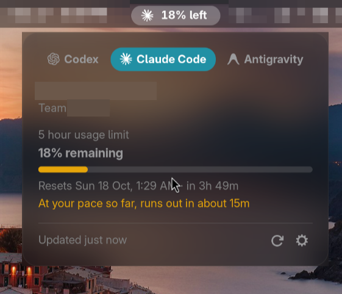
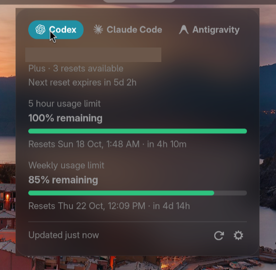

<div align="center">


# AI Usage

See how much of your AI coding limits is left, right in the GNOME top bar.





</div>

## Features

- **Codex, Claude Code and Antigravity** in one menu, with a tab for each.
- **5-hour limit in the top bar**, for example `78% left`.
- **Every limit the tool reports**: how much is left, when it resets, and a
  warning when your current pace would run out before the reset.
- **Private**: reads only what the official CLIs report. No tokens, no
  telemetry, no quota spent.

## Requirements

- GNOME Shell 49 or 50
- At least one of these CLIs, installed and signed in:

| Tool | CLI | Notes |
|---|---|---|
| Codex | `codex` | ChatGPT sign-in |
| Claude Code | `claude` | Pro, Max or Team plan; run `claude update` if `/usage` is missing |
| Antigravity | `agy` | Version 1.1.11 or later |

The CLIs are found in `PATH` and in the usual install locations (`~/.local/bin`,
npm, nvm, Bun, Volta, pnpm, mise, asdf). Otherwise set the path in Settings.

## Installation

```sh
git clone https://github.com/cgaswin/ai-usage.git
cd ai-usage
make install
```

Log out and back in, then enable it:

```sh
gnome-extensions enable ai-usage@cgaswin.github.io
```

## Usage

Click the indicator to open the menu. Use the refresh button to check now, or
the gear to open Settings, where you can:

- show or hide each tool
- change how often it checks (default: every 5 minutes)
- set a CLI's path if it is not found

### Instant updates for Claude Code (optional)

Claude Code can report its limits after every reply through its
[status line](https://code.claude.com/docs/en/statusline). Add this to
`~/.claude/settings.json`:

```json
"statusLine": {
  "type": "command",
  "command": "gjs -m ~/.local/share/gnome-shell/extensions/ai-usage@cgaswin.github.io/tools/claude-statusline.js"
}
```

This replaces any status line you already have.

## How it works

Each check runs the tool's own usage report. None of them send a prompt to a
model.

| Tool | Command |
|---|---|
| Codex | `codex app-server` (`account/rateLimits/read`) |
| Claude Code | `claude -p /usage`, `claude auth status` |
| Antigravity | `agy -p /usage` |

The extension never reads credential files, tokens, cookies or keyrings, and
makes no network requests of its own.

## Troubleshooting

| Problem | Fix |
|---|---|
| *CLI not found* | Run `command -v claude` (or `codex`, `agy`) and set that path in Settings. |
| *agy is signed out* | Run `agy` once in a terminal to sign in. |
| *Claude Code is too old* | Run `claude update`. |

Logs: `journalctl -f -o cat /usr/bin/gnome-shell | grep 'AI Usage'`

## Development

```sh
make link     # symlink this checkout into the extensions folder
make nested   # run a nested GNOME Shell for testing
make pack     # build the zip in dist/
```

GNOME Shell loads extension code only at startup, so restart the nested shell
after each change.

## License

[GPL-2.0-or-later](LICENSE). Icon credits are in
[icons/SOURCES.md](icons/SOURCES.md).

Not affiliated with OpenAI, Anthropic or Google. Product names and logos are
trademarks of their owners.
